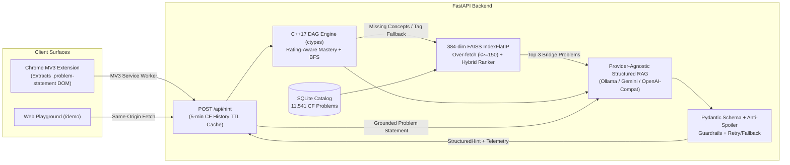

# BridgeCF — Adaptive Codeforces Hint Engine

[](https://github.com/Krishna27Singh/BridgeCF/actions/workflows/ci.yml)
[](https://github.com/Krishna27Singh/BridgeCF/releases)
[](LICENSE)
[](https://bridgecf-api.onrender.com/demo)

BridgeCF diagnoses why a competitive programmer is stuck on a Codeforces problem, retrieves unsolved stepping-stone ("bridge") problems calibrated to their skill gap, and delivers progressive 3-stage Socratic hints without spoiling the solution.

[**Live Demo: bridgecf-api.onrender.com/demo**](https://bridgecf-api.onrender.com/demo)

Instead of acting as a generic LLM wrapper, BridgeCF combines a **C++17 concept-prerequisite DAG engine (`ctypes`)**, **rating-aware user mastery over live Codeforces history**, a **SQLite + 384-dim FAISS hybrid ranker across 11,541 Codeforces problems**, and a **provider-agnostic structured RAG pipeline** with programmatic anti-spoiler guardrails.

The Codeforces catalog and FAISS index are rebuilt every three days by [GitHub Actions](.github/workflows/refresh-index.yml) and published at the stable [`index-latest` release](https://github.com/Krishna27Singh/BridgeCF/releases/download/index-latest/bridgecf-index.tar.gz) URL for runtime hydration.

---

## System Architecture



---

## Core Engineering Components

| Layer | Implementation Details |
|---|---|
| **C++17 Prerequisite DAG Engine** | Thread-safe (`std::shared_mutex`) native shared library (`backend/engine/graph_engine.cpp`) compiled with `-O3 -std=c++17` and invoked via zero-copy Python `ctypes`, with an automatic Python BFS fallback. |
| **Rating-Aware Mastery & Caching** | Evaluates user submission history per tag against the target problem's rating window (`>= R - 300`), falls back to target algorithmic tags when all prerequisites are mastered, and caches Codeforces `user.status` responses in memory (5-min TTL). |
| **SQLite + FAISS Hybrid Ranker** | Indexes **11,541 real Codeforces problems** using `sentence-transformers/all-MiniLM-L6-v2` (384-dim normalized vectors in FAISS `IndexFlatIP`). Over-fetches `max(top_k * 25, 150)` candidates, excludes already-solved problems, and reranks via `0.45 * semantic + 0.35 * concept_coverage + 0.20 * pedagogical_difficulty` (prioritizing `[R - 300, R - 100]`). |
| **Grounded Structured RAG** | Grounds hints in the actual problem statement (extracted directly from Codeforces' `.problem-statement` DOM by the extension or via a cached 3-second backend parser on `/demo`) plus verified rating, tags, and bridge metadata—preventing title-based hallucinations. |
| **Anti-Spoiler Guardrails & Providers** | Validates strict Pydantic `StructuredHint` JSON (strips markdown fences, enforces zero code-block leaks, performs 1 corrective retry + 429 exponential backoff, and falls back deterministically). Supports `openai_compat` (Groq / OpenAI), `gemini` (`x-goog-api-key` header), `ollama`, and `fallback`. |
| **Chrome MV3 Extension & `/demo`** | MV3 service worker (`background.js`) eliminates HTTPS-to-HTTP mixed-content blocks on Codeforces; regex parses `/problemset/`, `/contest/`, and `/gym/` URLs; injects progressive 3-level reveal cards and isolated latency badges (`graph_ms`, `cf_fetch_ms`, `total_ms`). |
| **CI/CD & Release Automation** | GitHub Actions runs C++ compilation, `ruff`, `pytest`, extension JS syntax checks (`node --check`), offline eval gates, and Linux `docker-build` on every PR and daily schedule. Dependabot keeps dependencies current, and Release Please automates semantic versioning, `CHANGELOG.md`, and zipped Chrome extension release artifacts. |

---

## Evaluation Results

BridgeCF ships with a reproducible 50-case evaluation suite (`backend/evals/run_evals.py`) supporting both a deterministic CI offline ablation and live end-to-end benchmarking over the full ingested catalog.

### 1. Live 11,541-Problem Benchmark (`--mode live`)

Evaluated across **50 unique real Codeforces problems** in SQLite + FAISS, with **15 live structured-hint LLM generations** (`LLM_PROVIDER=openai_compat` via Groq):

| Metric | Vector-Only Baseline | BridgeCF Hybrid | Delta |
|---|---:|---:|---:|
| **Recall@3** | `0.880` | **`0.980`** | `+0.100 (+11.4%)` |
| **Recall@5** | `0.960` | **`0.980`** | `+0.020` |
| **MRR** | `0.826` | **`0.980`** | `+0.154 (+18.6%)` |
| **Pedagogical Difficulty Hit Rate** | `1.000` | **`1.000`** | — |
| **Graph Mastery + BFS p50 / p95** | — | **`1.03 ms / 6.30 ms`** | Isolated from HTTP I/O |
| **Hybrid Retrieval p50 / p95** | — | **`35.52 ms / 70.34 ms`** | 11,541-problem catalog |
| **Codeforces API Cold Fetch** | — | `1901.92 ms` | Cached 5 min in API |
| **JSON Schema Pass Rate** | — | **`1.000`** (15/15) | Strict Pydantic contract |
| **Anti-Spoiler Pass Rate** | — | **`1.000`** (15/15) | Zero code/solution leaks |
| **Concept Alignment Rate** | — | **`1.000`** (15/15) | Grounded in target tags |

### 2. Offline Hard-Distractor Ablation (`--mode offline`, CI Gate)

Stress-tests the hybrid ranker against adversarial distractors (high-similarity already-solved problems, `+400` difficulty traps, and off-concept neighbors):

| Metric | Vector-Only Baseline | BridgeCF Hybrid |
|---|---:|---:|
| **Recall@3** | `0.380` | **`1.000`** |
| **Recall@5** | `0.380` | **`1.000`** |
| **MRR** | `0.458` | **`0.690`** |
| **Pedagogical Difficulty Hit Rate** | `0.333` | **`0.747`** |
| **Isolated C++ BFS p50 / p95** | — | **`0.084 us / 0.458 us`** |
| **Hybrid Retrieval p50 / p95** | — | **`0.0136 ms / 0.0749 ms`** |
| **JSON Schema / Anti-Spoiler / Alignment** | — | **`1.000 / 1.000 / 1.000`** |

---

## Project Structure

```text
BridgeCF/
├── .github/
│   ├── dependabot.yml               # Weekly pip & GitHub Actions dependency PRs
│   └── workflows/
│       ├── ci.yml                   # C++ build, ruff, pytest, evals, node --check, docker-build + nightly cron
│       └── release-please.yml       # Auto-versioning, CHANGELOG, & zipped extension release upload
├── backend/
│   ├── app/
│   │   ├── main.py                  # FastAPI routes (/health, /ready, /demo, /api/hint) + CF TTL cache
│   │   ├── config.py                # Pydantic settings (JSON/CSV CORS, multi-provider config)
│   │   ├── db.py                    # SQLite schema (problems, prerequisites, user cache, hint_logs)
│   │   ├── graph_engine.py          # ctypes bridge to engine.so + rating-aware mastery
│   │   ├── vector_engine.py         # FAISS IndexFlatIP + hybrid bridge ranker
│   │   ├── schemas.py               # Request/response & StructuredHint contracts
│   │   ├── services/llm_service.py  # Provider-agnostic RAG, JSON fence extraction, guardrails, 429 retry
│   │   ├── scripts/build_knowledge_base.py  # Full Codeforces API ingestion + batch embeddings
│   │   └── static/demo.html         # Live interactive web playground
│   ├── engine/graph_engine.cpp      # C++17 thread-safe DAG BFS implementation
│   ├── evals/
│   │   ├── dataset_50.json          # 50 curated Codeforces evaluation cases
│   │   └── run_evals.py             # Offline & live ablation harness
│   ├── tests/                       # Unit, API, guardrail, and extension manifest tests
│   ├── Dockerfile                   # CPU-only PyTorch + pre-cached MiniLM + native Linux C++ build
│   ├── entrypoint.sh                # Auto-bootstraps DB/FAISS index on cold container start
│   └── Makefile                     # Compiles engine/graph_engine.cpp -> engine.so
├── extension/                       # Chrome Manifest V3 extension
│   ├── manifest.json
│   ├── background.js                # Service worker handling API calls
│   ├── content.js                   # URL regex parser, statement extractor, & sidebar UI injection
│   ├── popup.html / popup.js        # Handle & API URL settings + live /health tester
│   └── styles.css
├── docker-compose.yml
└── render.yaml
```

---

## Quick Start (Local Development)

### 1. Clone, Install & Build the C++ Engine

```bash
git clone [https://github.com/Krishna27Singh/BridgeCF.git](https://github.com/Krishna27Singh/BridgeCF.git)
cd BridgeCF

python3 -m venv backend/venv
source backend/venv/bin/activate
python -m pip install -r backend/requirements.txt

# Compile C++17 DAG shared library (backend/engine.so)
make -C backend
```

### 2. Configure Your LLM Provider

```bash
cp backend/.env.example backend/.env
```

Edit `backend/.env` and pick one provider:

* **Groq / OpenAI-Compatible (`openai_compat`):**
  ```env
  LLM_PROVIDER=openai_compat
  OPENAI_API_KEY=your_api_key
  OPENAI_BASE_URL=[https://api.groq.com/openai/v1](https://api.groq.com/openai/v1)
  OPENAI_MODEL=openai/gpt-oss-20b
  ```
* **Google Gemini (`gemini`):**
  ```env
  LLM_PROVIDER=gemini
  GEMINI_API_KEY=your_gemini_key
  GEMINI_MODEL=gemini-3.5-flash-lite
  ```
* **Local Ollama (`ollama` — 100% offline):**
  ```env
  LLM_PROVIDER=ollama
  OLLAMA_BASE_URL=[http://127.0.0.1:11434](http://127.0.0.1:11434)
  OLLAMA_MODEL=llama3.2
  ```
* **Deterministic Fallback (`fallback` — no API key required):**
  ```env
  LLM_PROVIDER=fallback
  ```

### 3. Ingest the Codeforces Catalog & Start the Server

```bash
cd backend

# Quick dev subset (~1,000 problems)
./venv/bin/python -m app.scripts.build_knowledge_base --limit 1000

# Or full catalog (~11,541 problems)
./venv/bin/python -m app.scripts.build_knowledge_base

# Start FastAPI
./venv/bin/uvicorn app.main:app --host 127.0.0.1 --port 8000 --reload
```

Verify readiness at `http://127.0.0.1:8000/ready` and open the interactive playground at **`http://127.0.0.1:8000/demo`**.

---

## Install Chrome Extension (Free — No Chrome Web Store Required)

1. Download the latest extension `.zip` from [GitHub Releases](https://github.com/Krishna27Singh/BridgeCF/releases).
2. Unzip the downloaded file.
3. Open `chrome://extensions/`, enable **Developer mode**, click **Load unpacked**, and select the unzipped extension folder.
4. Open the extension popup, enter your Codeforces handle, and click **Save**. The live Render API is selected by default; developers can change the editable API Base URL to `http://127.0.0.1:8000` for local development.

Open a Codeforces problem page (for example, `https://codeforces.com/problemset/problem/1985/D`) to use the hint panel. Render's free tier may take approximately **30–60 seconds** to wake on the first request after 15 minutes of inactivity.

---

## API Overview

| Method | Endpoint | Description |
|---|---|---|
| `GET` | `/health` | Liveness probe returning engine & vector index status. |
| `GET` | `/ready` | Readiness probe returning loaded problem count and engine readiness. |
| `GET` | `/demo` | Self-contained interactive web playground. |
| `POST` | `/api/hint` | Runs rating-aware C++ DAG diagnosis, hybrid bridge retrieval, and grounded 3-level Socratic hint generation. |

Example `POST /api/hint` payload:

```json
{
  "user_handle": "Krishna_Singh27",
  "problem_id": "1985_D",
  "problem_statement": "Given an n by m grid consisting of '.' and '#' characters..."
}
```

---

## Testing & Running Evaluations

```bash
# Lint & unit/API/guardrail tests
backend/venv/bin/python -m ruff check backend
backend/venv/bin/python -m pytest -v backend/tests

# Extension JS syntax validation
node --check extension/background.js extension/content.js extension/popup.js

# Deterministic offline ablation (CI gate)
PYTHONPATH=backend backend/venv/bin/python -m evals.run_evals --mode offline

# Live benchmark against ingested SQLite + FAISS + configured LLM
cd backend
./venv/bin/python -m evals.run_evals --mode live --llm-sample 15 --llm-delay 5.0
cat evals/report_summary.md
```

---

## Docker & Cloud Deployment

### Local Docker Compose

```bash
docker compose up --build
```

Persists SQLite and FAISS indices in the `bridgecf_data` volume and runs an automated `/health` check.

### Google Cloud Run (Recommended — 2 GiB RAM)

PyTorch CPU + `all-MiniLM-L6-v2` + FAISS requires ~700–900 MB RAM at runtime, so deploy with at least `2Gi` memory (avoid 512 MB free tiers):

```bash
gcloud run deploy bridgecf-api \
  --source ./backend \
  --region asia-south1 \
  --allow-unauthenticated \
  --memory 2Gi \
  --cpu 2 \
  --timeout 300 \
  --set-env-vars "LLM_PROVIDER=openai_compat,OPENAI_API_KEY=YOUR_KEY,OPENAI_BASE_URL=[https://api.groq.com/openai/v1,OPENAI_MODEL=openai/gpt-oss-20b,BOOTSTRAP_LIMIT=3000](https://api.groq.com/openai/v1,OPENAI_MODEL=openai/gpt-oss-20b,BOOTSTRAP_LIMIT=3000)"
```

---

## Documentation & Community

- [Contributing guide](CONTRIBUTING.md) — local setup, checks, branch/commit conventions, and pull request checklist.
- [Public roadmap](ROADMAP.md) — planned platform, product, and reliability work.
- [Security policy](SECURITY.md) — supported versions, data handling, and private vulnerability reporting.
- [Code of Conduct](CODE_OF_CONDUCT.md) — community expectations and enforcement.

---

## Scaling Design Notes

To scale beyond single-key free-tier LLM quotas in production:
- **Composite-Key Hint Caching:** Cache validated `StructuredHint` JSON keyed by `(problem_id, sorted(missing_concepts), top_bridge_id)` in Redis/SQLite—immutable Codeforces problems let repeated bottleneck signatures resolve in `<50 ms` at zero LLM cost.
- **Multi-Provider Failover:** Because `LLMHintService` is provider-agnostic, requests can fail over automatically across `openai_compat` (Groq/OpenAI) → `gemini` → deterministic fallback on HTTP `429`/`503`.
- **Distributed History Cache:** Replace the single-process 5-minute TTL cache with Redis for multi-replica Cloud Run deployments.
