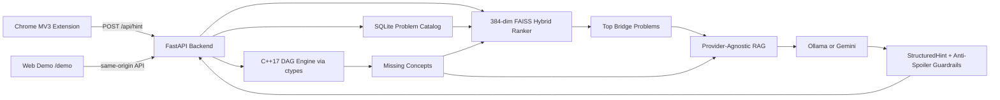

# BridgeCF

[](https://github.com/Krishna27Singh/BridgeCF/actions/workflows/ci.yml)
[](https://github.com/Krishna27Singh/BridgeCF/releases)

BridgeCF is an adaptive Codeforces hint engine. It combines a C++ concept DAG, user submission history, a SQLite problem catalog, FAISS semantic retrieval, hybrid bridge ranking, and a provider-agnostic structured RAG hint service.

## Architecture



## What Is Implemented

- C++17 shared-library DAG engine loaded through Python `ctypes` with a Python BFS fallback.
- SQLite problem, prerequisite, user-cache, and hint-log tables.
- 384-dimensional `sentence-transformers/all-MiniLM-L6-v2` embeddings with normalized FAISS `IndexFlatIP`.
- JIT Codeforces problem ingestion and a weighted hybrid bridge ranker.
- FastAPI health, readiness, demo, and hint endpoints.
- Pydantic structured hints with one corrective retry and deterministic fallback.
- Ollama, Gemini, OpenAI-compatible, and fallback providers.
- MV3 Chrome extension with popup configuration and service-worker API calls.
- Docker, Docker Compose, Render, pytest, Ruff, GitHub Actions, and Release Please automation.

## Clone and Run Locally

```bash
git clone https://github.com/Krishna27Singh/BridgeCF.git
cd BridgeCF

python3.11 -m venv backend/venv
source backend/venv/bin/activate
python -m pip install -r backend/requirements.txt

make -C backend
python backend/app/scripts/build_knowledge_base.py --limit 1000

cd backend
uvicorn app.main:app --host 127.0.0.1 --port 8000 --reload
```

Open `http://127.0.0.1:8000/demo`. Full catalog ingestion can omit `--limit`:

```bash
python backend/app/scripts/build_knowledge_base.py
```

Configure providers by copying the environment template:

```bash
cp backend/.env.example backend/.env
```

Supported `LLM_PROVIDER` values are `ollama`, `gemini`, `openai_compat`, and `fallback`. A provider connection failure or spoiler/schema failure returns the deterministic structured fallback.

## Chrome Extension

1. Open `chrome://extensions`.
2. Enable Developer mode.
3. Choose `Load unpacked` and select `extension/`.
4. Open the extension popup and set the Codeforces handle and API URL.
5. The default API URL is `http://127.0.0.1:8000`.

The MV3 service worker performs backend requests, avoiding direct HTTPS-to-HTTP fetches from Codeforces pages.

## Tests and Evaluation

```bash
backend/venv/bin/python -m ruff check backend
backend/venv/bin/python -m pytest -v backend/tests

PYTHONPATH=backend backend/venv/bin/python \
  -m evals.run_evals --mode offline
```

Live evaluation uses the real SQLite and FAISS assets and configured provider:

```bash
LLM_PROVIDER=ollama PYTHONPATH=backend backend/venv/bin/python \
  -m evals.run_evals --mode live

LLM_PROVIDER=gemini PYTHONPATH=backend backend/venv/bin/python \
  -m evals.run_evals --mode live
```

Live mode writes `backend/evals/report_summary.md` and `backend/evals/latest_report.json`.

## Docker

```bash
docker compose up --build
```

The compose volume persists SQLite and FAISS assets under `/app/backend/data`. The container health check calls `/health`.

## Evaluation Results

### Offline Hard-Distractor Ablation

| Metric | Vector-Only | BridgeCF Hybrid |
|---|---:|---:|
| Recall@3 | 0.380 | 1.000 |
| Recall@5 | 0.380 | 1.000 |
| MRR | 0.458 | 0.690 |
| Pedagogical Difficulty Hit Rate | 0.333 | 0.747 |
| JSON Schema Pass Rate | - | 1.000 |
| Anti-Spoiler Pass Rate | - | 1.000 |
| Concept Alignment Rate | - | 1.000 |

These values are generated by the deterministic offline hard-distractor suite. Live 10k benchmarks should be pasted here after running `--mode live` against a fully ingested database.
